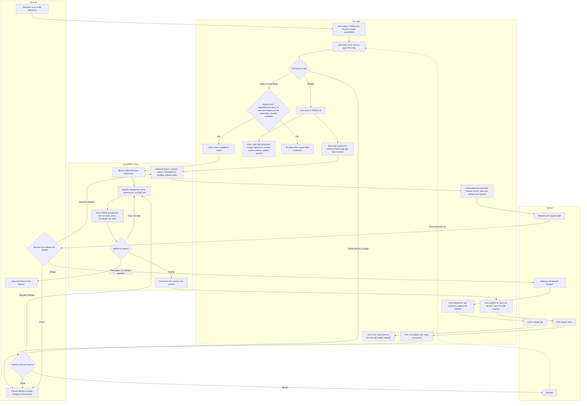
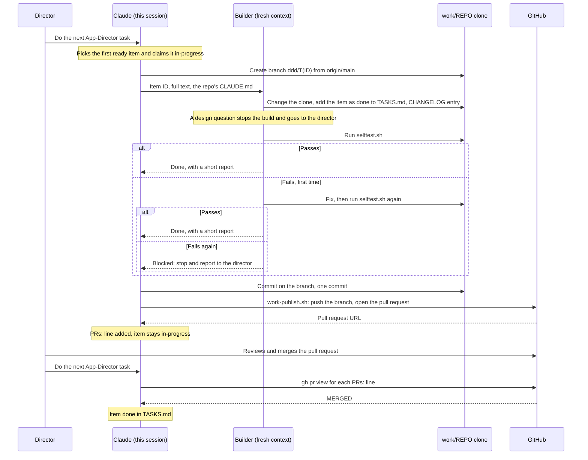

# Framework work

This repository builds the items of the three framework repos, App-Director, Godot-Director and SaaSAllTheThings, with App Director. Each item is built in a clone of its repo under `work/`, which is gitignored, and reaches the repo as one pull request. The director reviews and merges each pull request on GitHub; the agent never merges one.

The rules are in AGENTS.md › Project rules, under Framework work. This page shows how they fit together.

## The flow

In the diagram, `REPO` stands for the framework's name: App-Director, Godot-Director or SaaSAllTheThings.

## The sequence

One item, from the request to its merge.

## Where items come from

A decision, or a difference that `tools/audit.sh` finds between a framework's latest release and its skill page, becomes an item in TASKS.md. `bash tools/push-alignment.sh` lists the items for the differences, and `--add` writes them. Each item's `Touches` names its clone under `work/`.

## The builder

The builder follows that repo's own `CLAUDE.md` (`.claude/CLAUDE.md` in SaaSAllTheThings), not the templates under its `framework/` and `project/` folders, and not this repo's rules for code. The gate is that repo's `selftest.sh`, in place of `bash tools/check.sh`. Godot-Director's `selftest.sh` takes the path to Godot 4.3 or newer.

## Done means merged

An item stays in-progress, with a `PRs:` line that lists its pull requests (for example `Godot-Director #2 (open)`), until all of them are merged. `/next-task` updates that line before it picks anything. A pull request closed without a merge goes to the director. The records here are committed without pausing, but this repo is pushed only when the director asks.

## What blocks an item

An item waits while an item it depends on isn't done, so an open pull request blocks the items that depend on its item. It also blocks an item whose `Touches` shares a file with it. Compare them with `gh pr view <n> -R Freakling/<repo> --json files`. The records every item adds (the root `TASKS.md` and `CHANGELOG.md`) don't count. Other items carry on, in the same repo too.

## After a merge

Each other open item branch in that repo gets `origin/main` merged in; it is never rebased or force-pushed. Where the record files conflict, keep both entries, and give a duplicate ID the next number. Then run that repo's `selftest.sh` and publish with `bash tools/work-publish.sh work/<repo>`, which updates the open pull request.

## Releases

A release comes when a change is complete. Once an item is done, with all its pull requests merged, the next `/next-task` proposes a release of each framework repo the item touched. The release covers everything merged in that repo since its last release, not only this item.

The proposal is a release pull request that follows the repo's own `CLAUDE.md`: the version bump, the `CHANGELOG.md` heading and the release notes. The release notes are the commit message, which `tools/work-publish.sh` turns into the pull request description. The director decides every release, and merging the pull request is the approval.

After the merge, `bash tools/work-release.sh work/<repo> <pull request number>` tags the merged commit `v<version>` and publishes the GitHub release with that description as its notes. Then an item here moves the docs links to the new tag and updates the pages for what the release ships.

## Reviewing and merging the pull requests

Each item the agent builds becomes one pull request in its framework's repo, on its own branch, and a release is a pull request too. Only the director merges: the agent never does, and the publish script never enables auto-merge.

**What reaches you.** The pull request's description is the item's commit message: its title is the commit's subject, and its body says why the change was made. For a release pull request, the description is the release notes. The builder runs the framework's selftest before the commit, so a pull request that reaches you has passed it. Review three things: the change itself, in the Files changed tab; the records the item adds to that repo (the item, marked done, at the top of its root `TASKS.md` with that repo's next ID, and an entry at the top of its `CHANGELOG.md`); and the notes the agent writes for you, such as anything it asks you to look at and any choice it made while building.

**What you do.**

1. **Review on GitHub.** Open the pull request from the link the agent gives you. Read the description, then the Files changed tab, then the two records. If something needs changing, tell the agent what to change. It makes the change on the same branch and publishes it again, which updates the same pull request.
2. **Merge with "Squash and merge".** Open the menu next to the merge button and choose "Squash and merge", not "Create a merge commit". A GitHub merge commit has two parents, and the Claude plugin directory's scanner has rejected every such commit, while it has accepted the single-parent ones. A squash merge puts one commit on the default branch. This is being confirmed with a squash-merged commit, so until it is proven, squash is the practice.
3. **Deal with a blocked merge.**
    - "Merging is blocked due to failing merge requirements": a requirement that the repo sets for merging isn't met yet, such as a check that has failed or hasn't finished. The checks under the merge box show which one.
    - "This branch has conflicts that must be resolved": two open pull requests on the same repo each add an entry at the top of `TASKS.md` and `CHANGELOG.md`, so merging one makes the other's entries conflict. This is a conflict in the records, not in the code. Tell the agent, or run `/next-task`: it merges the default branch into the open branch, keeps both entries (a duplicate ID gets the next number), reruns the selftest and publishes.
4. **Let the next `/next-task` run handle the merge.** It marks the item done, brings each other open branch in that repo up to date, and proposes a release of each framework the item touched, covering everything merged there since its last release.
5. **Review and merge the release pull request.** It holds the version files, the `CHANGELOG.md` heading and the release notes. Check that the version is right: the agent proposes it, and you can change it in review. Each version file and the `CHANGELOG.md` heading should carry the same version. Merge it with the same squash merge.
6. **Let the agent publish the release.** Once it is merged, the agent tags the merge commit `v<version>`, publishes the GitHub release with the notes, then moves the docs links to the new tag and updates the pages for what the release ships. That docs change is committed here, and pushed when you ask.

Closing a pull request without merging it takes it out of the flow. The agent brings it to you at the next check of the pull requests, and the item stays in-progress until you decide. A change you hold back, such as one waiting for a user acceptance test, stays on a local branch with no pull request until you ask for one. Merging one pull request makes the others in that repo conflict on the records; each fix is another push and another selftest, so one open pull request per repo at a time keeps the work down.

## The tools

- `tools/work-clones.sh` clones the three repos into `work/`, or fetches the clones already there. It never resets or switches a clone.
- `tools/work-publish.sh work/<repo>` pushes the item's branch and opens its pull request. It refuses the default branch, never merges and never force-pushes. `--dry-run` prints the commands without running them.
- `tools/work-release.sh work/<repo> <pull request number>` tags the merged release commit and publishes the GitHub release. It refuses when the pull request isn't merged, the version files disagree, the tag or the release already exists, or the description has no "How to install" section. It pushes only the new tag and never merges, force-pushes or moves a tag. `--dry-run` prints the tag, the notes and the commands without running them.
