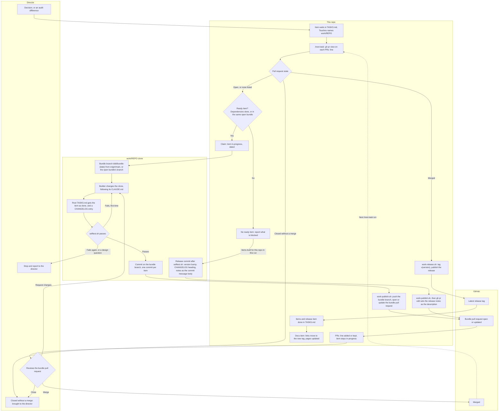
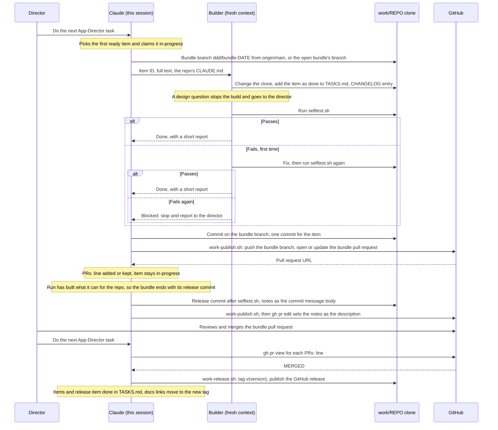

# Framework work

This repository builds the items of the three framework repos, App-Director, Godot-Director and SaaSAllTheThings, with App Director. Each item is built in a clone of its repo under `work/`, which is gitignored. Items reach a repo through one bundle pull request per repo: each item is one commit on it, and the bundle ends with its release commit. The director reviews and merges each bundle on GitHub; the agent never merges one.

The rules are in AGENTS.md › Project rules, under Framework work. This page shows how they fit together.

## The flow

In the diagram, `REPO` stands for the framework's name: App-Director, Godot-Director or SaaSAllTheThings.

## The sequence

One item, from the request to the merge of its bundle, with the release commit and the tag after the merge.

## Where items come from

A decision, or a difference that `tools/audit.sh` finds between a framework's latest release and its skill page, becomes an item in TASKS.md. `bash tools/push-alignment.sh` lists the items for the differences, and `--add` writes them. Each item's `Touches` names its clone under `work/`.

## The builder

The builder follows that repo's own `CLAUDE.md` (`.claude/CLAUDE.md` in SaaSAllTheThings), not the templates under its `framework/` and `project/` folders, and not this repo's rules for code. The gate is that repo's `selftest.sh`, in place of `bash tools/check.sh`. Godot-Director's `selftest.sh` takes the path to Godot 4.5 or newer.

## Done means merged

An item stays in progress, with a `PRs:` line that lists the bundle pull requests it is in (for example `Godot-Director #2 (open)`), until all of them are merged. The items of one bundle share that line. `/next-task` updates the line before it picks anything, and a pull request closed without a merge goes to the director. The records here are committed without pausing, but this repo is pushed only when the director asks.

## What blocks an item

An item waits while an item it depends on isn't done. An open bundle blocks nothing: new items for that repo go on its branch, and an item whose `Depends on` names an item in that bundle is built on the branch after it. Any other dependency that isn't done makes the item wait; the items that don't depend on it carry on.

## After a merge

The merged bundle's items are done, and that repo's next item starts a new bundle from the latest `origin/main`. There are no other open item branches to bring up to date.

## Releases

A release rides in the bundle. Once a run has built the items it can for a repo, it ends that repo's bundle with a release commit, so one merge takes the items and their release. The commit follows that repo's `CLAUDE.md`: the version bump in the version files it lists, the `CHANGELOG.md` heading, and the release notes as the commit message body, after the selftest. `tools/work-publish.sh` pushes it, and `gh pr edit --body-file` then makes the notes the bundle's description. The version is the agent's proposal, covering everything in the bundle and merged since that repo's last release; the director can change it in review.

After the merge, `bash tools/work-release.sh work/<repo> <pull request number>` tags the merged commit `v<version>` and publishes the GitHub release, with that description as its notes. The bundle's items and its release item are then done, and an item here moves the docs links and the pin in `frameworks.lock` to the new tag, and updates the pages for what the release ships.

An item added to a bundle that already ends with its release commit puts its CHANGELOG entry under that version heading, since the version isn't published yet, and the notes in the description are updated to match.

## Reviewing and merging the pull requests

Each framework repo has one bundle pull request at a time. Every item the agent builds for that repo is a commit on it, and the release commit ends it. Only the director merges: the agent never does, and the publish script never enables auto-merge.

**What reaches you.** The bundle's title names every item it carries, and its body lists them, one line each with its source; `gh pr edit` keeps both up to date. Once the release commit is in, the description is the release notes. The builder runs the framework's selftest before each commit, so a pull request that reaches you has passed it. Review three things: the change itself, in the Files changed tab; the records each item adds to that repo (the item, marked done, at the top of its root `TASKS.md` with that repo's next ID, and an entry at the top of its `CHANGELOG.md`); and the notes the agent writes for you, such as anything it asks you to look at and any choice it made while building.

**What you do.**

1. **Review on GitHub.** Open the pull request from the link the agent gives you. Read the description, then the Files changed tab, then the records of each item. If something needs changing, tell the agent what to change. It makes the change on the same branch and publishes it again, which updates the same pull request.
2. **Check the release commit.** It's the bundle's last commit: the version files, the `CHANGELOG.md` heading and the release notes, which become the description. Check that the version is right, since the agent proposes it and you can change it in review. Each version file and the `CHANGELOG.md` heading should carry the same version.
3. **Merge with "Squash and merge".** Open the menu next to the merge button and choose "Squash and merge", not "Create a merge commit". A GitHub merge commit has two parents, and the Claude plugin directory's scanner has rejected every such commit, while it has accepted the single-parent ones. A squash merge puts one commit on the default branch. This is being confirmed with a squash-merged commit, so until it is proven, squash is the practice.
4. **Deal with a blocked merge.**
    - "Merging is blocked due to failing merge requirements": a requirement that the repo sets for merging isn't met yet, such as a check that has failed or hasn't finished. The checks under the merge box show which one.
    - "This branch has conflicts that must be resolved": the bundle's records (`TASKS.md` and `CHANGELOG.md`) clash with the default branch. This is a conflict in the records, not in the code. Tell the agent to resolve it on the bundle branch and publish again.
5. **Let the next `/next-task` run handle the merge.** It tags the merge commit `v<version>` and publishes the GitHub release with the notes. It then marks the bundle's items done and moves the docs links to the new tag, updating the pages for what the release ships. That docs change is committed here, and pushed when you ask.

Closing the bundle pull request without merging it takes its items out of the flow. The agent brings it to you at the next check of the pull requests, and the items stay in progress until you decide. One bundle is open per repo at a time, so two open pull requests never add records to the same files.

## The tools

- `tools/work-clones.sh` clones the three repos into `work/`, or fetches the clones already there. It never resets or switches a clone.
- `tools/work-publish.sh work/<repo>` pushes the bundle branch and opens its pull request, or updates the one already open. It refuses the default branch, never merges and never force-pushes. `--dry-run` prints the commands without running them.
- `tools/work-release.sh work/<repo> <pull request number>` tags the merged commit and publishes the GitHub release. It refuses when the pull request isn't merged, the version files disagree, the tag or the release already exists, or the description has no "How to install" section. It pushes only the new tag and never merges, force-pushes or moves a tag. `--dry-run` prints the tag, the notes and the commands without running them.
