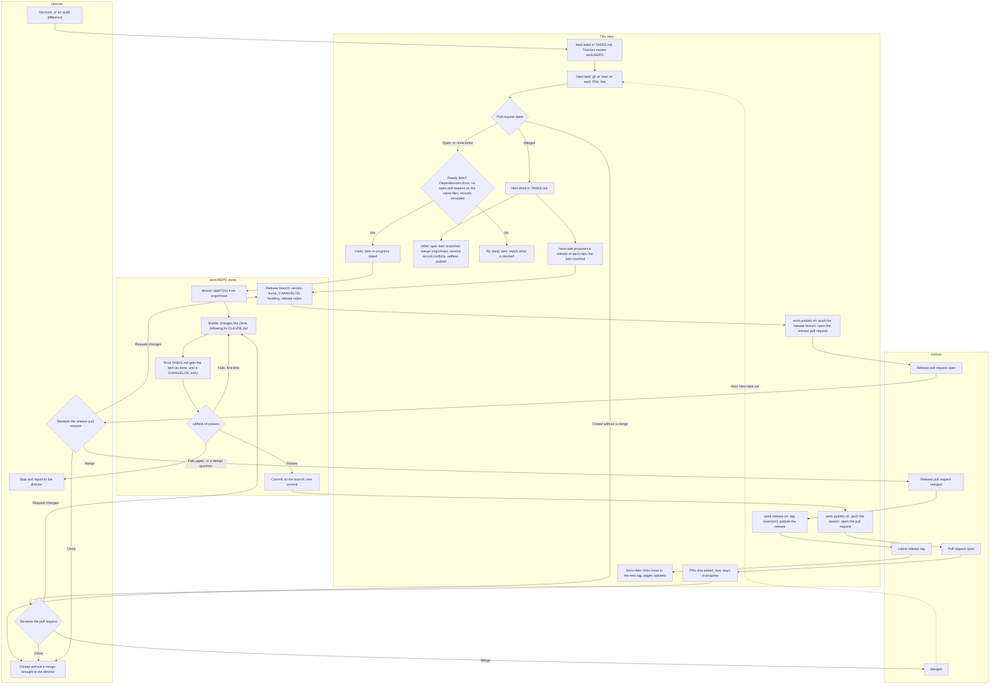
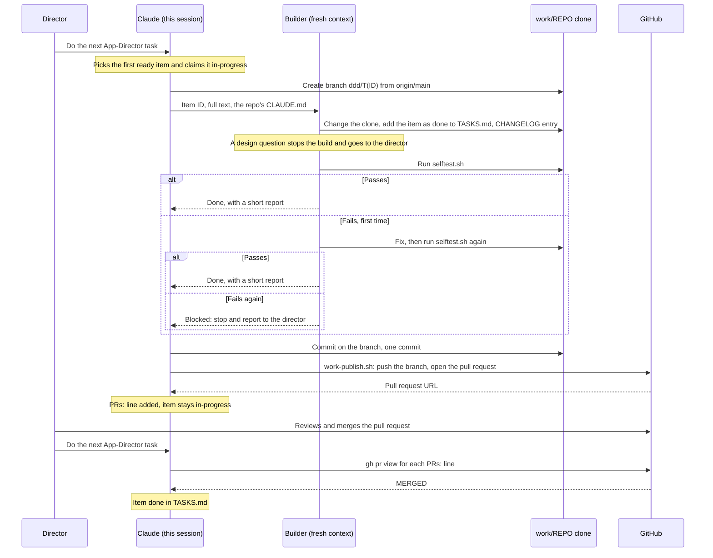

# Framework work

This repository builds the items of the three framework repos, App-Director, Godot-Director and SaaSAllTheThings, with App Director. Each item is built in a clone of its repo under `work/`, which is gitignored, and reaches the repo as one pull request. The director reviews and merges each pull request on GitHub; the agent never merges one.

The rules are in AGENTS.md › Project rules, under Framework work. This page shows how they fit together.

## The flow

In the diagram, `REPO` stands for the framework's name: App-Director, Godot-Director or SaaSAllTheThings.

## The sequence

One item, from the request to its merge.

## Where items come from

A decision, or a difference that `tools/audit.sh` finds between a framework's latest release and its skill page, becomes an item in TASKS.md. `bash tools/push-alignment.sh` lists the items for the differences, and `--add` writes them. Each item's `Touches` names its clone under `work/`.

## The builder

The builder follows that repo's own `CLAUDE.md` (`.claude/CLAUDE.md` in SaaSAllTheThings), not the templates under its `framework/` and `project/` folders, and not this repo's rules for code. The gate is that repo's `selftest.sh`, in place of `bash tools/check.sh`. Godot-Director's `selftest.sh` takes the path to Godot 4.3 or newer.

## Done means merged

An item stays in-progress, with a `PRs:` line that lists its pull requests (for example `Godot-Director #2 (open)`), until all of them are merged. `/next-task` updates that line before it picks anything. A pull request closed without a merge goes to the director. The records here are committed without pausing, but this repo is pushed only when the director asks.

## What blocks an item

An item waits while an item it depends on isn't done, so an open pull request blocks the items that depend on its item. It also blocks an item whose `Touches` shares a file with it. Compare them with `gh pr view <n> -R Freakling/<repo> --json files`. The records every item adds (the root `TASKS.md` and `CHANGELOG.md`) don't count. Other items carry on, in the same repo too.

## After a merge

Each other open item branch in that repo gets `origin/main` merged in; it is never rebased or force-pushed. Where the record files conflict, keep both entries, and give a duplicate ID the next number. Then run that repo's `selftest.sh` and publish with `bash tools/work-publish.sh work/<repo>`, which updates the open pull request.

## Releases

A release comes when a change is complete. Once an item is done, with all its pull requests merged, the next `/next-task` proposes a release of each framework repo the item touched. The release covers everything merged in that repo since its last release, not only this item.

The proposal is a release pull request that follows the repo's own `CLAUDE.md`: the version bump, the `CHANGELOG.md` heading and the release notes. The release notes are the commit message, which `tools/work-publish.sh` turns into the pull request description. The director decides every release, and merging the pull request is the approval.

After the merge, `bash tools/work-release.sh work/<repo> <pull request number>` tags the merged commit `v<version>` and publishes the GitHub release with that description as its notes. Then an item here moves the docs links to the new tag and updates the pages for what the release ships.

## The tools

- `tools/work-clones.sh` clones the three repos into `work/`, or fetches the clones already there. It never resets or switches a clone.
- `tools/work-publish.sh work/<repo>` pushes the item's branch and opens its pull request. It refuses the default branch, never merges and never force-pushes. `--dry-run` prints the commands without running them.
- `tools/work-release.sh work/<repo> <pull request number>` tags the merged release commit and publishes the GitHub release. It refuses when the pull request isn't merged, the version files disagree, the tag or the release already exists, or the description has no "How to install" section. It pushes only the new tag and never merges, force-pushes or moves a tag. `--dry-run` prints the tag, the notes and the commands without running them.
